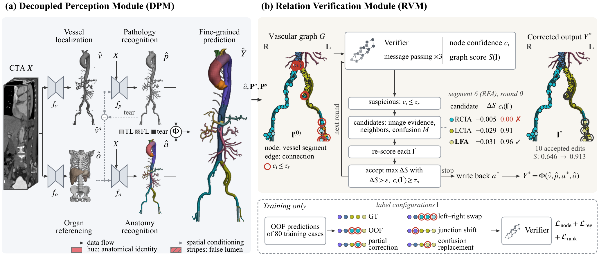

# DecoVer

## A Decouple-and-Verify Framework for Fine-Grained Comprehensive TAAD Segmentation

**Code will be released soon.**

### Framework Overview

DecoVer consists of a Decoupled Perception Module (DPM) and a Relation Verification Module (RVM).

[View the architecture diagram as a PDF](assets/architecture.pdf).
